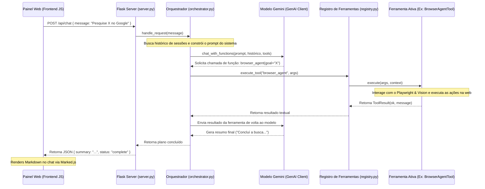

# Arquitetura do Sistema: Jarvis Rebuild

Este documento descreve a estrutura de diretórios, o fluxo de dados e os princípios de design adotados na reconstrução do Jarvis. Esta arquitetura foi projetada seguindo princípios de **Clean Architecture** e **Domain-Driven Design (DDD)** para ser modular, extensível e de fácil manutenção.

---

## 📂 Estrutura de Diretórios e Modularização

O projeto está dividido dentro da pasta raiz `app/` em 5 camadas lógicas bem definidas, garantindo que a lógica de interface, negócio e hardware estejam completamente isoladas:

```
app/
├── agent/                  # Camada de Inteligência e LLM
│   ├── modes/              # Modos específicos (Tutor ENEM, Chat Geral)
│   ├── tools/              # Ferramentas nativas do LLM (Ex: browser_agent, clipboard)
│   ├── orchestrator.py     # Cérebro: Orquestra o fluxo Chat -> LLM -> Execução
│   └── prompts.py          # Engenharia de Prompts e System Instructions
│
├── core/                   # Camada de Regras e Ciclo de Vida do Sistema
│   ├── app.py              # Inicializador global do aplicativo
│   ├── heartbeat.py        # Loop de atividades e consolidação de memória
│   ├── scheduler.py        # Agendamento de rotinas proativas
│   └── settings_manager.py # Configurações de ambiente (.env e JSONs)
│
├── domain/                 # Regras de Negócio e Domínio Puro (Sem dependência de hardware)
│   ├── actions.py          # Lógica pura de ações de arquivo
│   ├── chat.py             # Domínio do fluxo de mensagens
│   └── productivity.py     # Domínio de gerenciamento de tarefas/estudos
│
├── services/               # Serviços Infraestruturais (Hardware e APIs Externas)
│   ├── voice/              # Pipeline de voz (STT, TTS, Whisper, Edge-TTS)
│   ├── app_manager.py      # Controle e escaneamento do Windows Registry
│   ├── browser_agent.py    # Interface wrapper do Playwright (Navegador)
│   ├── window_control.py   # Controle de foco de janelas via ctypes/user32
│   └── vision.py           # Visão computacional com Gemini API
│
├── storage/                # Persistência de Dados (Repositórios e Bancos)
│   ├── session_store.py    # Gerenciamento de histórico de sessões do chat
│   ├── activity_store.py   # Logs de atividade diária
│   └── vector.py           # Banco vetorial local para RAG (Memória Semântica)
│
└── ui/                     # Camada de Apresentação e Interfaces Gráficas
    ├── panel/              # Painel Web Flask (HTML/CSS/JS)
    │   ├── api/            # Endpoints REST (ENEM, Settings, Dashboard)
    │   ├── static/         # CSS, Orb.js e panel.js (Frontend)
    │   ├── templates/      # Páginas HTML (index.html, camera-modal.html)
    │   └── server.py       # Servidor HTTP Flask local
    └── tray_icon.py        # Ícone de bandeja do sistema (Windows Tray)
```

---

## 🔄 Fluxo de Processamento de Requisições

Abaixo está o fluxo detalhado de como o Jarvis processa uma mensagem (seja ela via texto ou por comando de voz) e aciona as ferramentas:



---

## 🛠️ Design das Ferramentas (BaseTool Protocol)

Toda ferramenta implementada no Jarvis herda de `BaseTool` em `app/agent/tools/base.py`. Isso garante que futuras ferramentas possam ser adicionadas sem alterar a lógica de execução.

### Exemplo de implementação limpa (Template para futuras ferramentas):
```python
from __future__ import annotations
from typing import Any
from .base import BaseTool, ToolResult

class MinhaNovaFerramenta(BaseTool):
    @property
    def name(self) -> str:
        return "nome_da_ferramenta"

    @property
    def description(self) -> str:
        return "Descreva exatamente o que a ferramenta faz para o LLM entender."

    @property
    def parameters(self) -> dict[str, Any]:
        # Define os argumentos esperados no formato JSON Schema
        return {
            "type": "object",
            "properties": {
                "parametro_1": {
                    "type": "string",
                    "description": "Explicação do parâmetro 1"
                }
            },
            "required": ["parametro_1"]
        }

    def execute(self, args: dict[str, Any], context: dict[str, Any] | None = None) -> ToolResult:
        param = args.get("parametro_1")
        try:
            # Lógica principal da ferramenta aqui...
            # Se precisar acessar serviços do sistema, use o context:
            # vision = context.get("vision")
            
            return ToolResult(ok=True, message=f"Sucesso ao processar {param}!")
        except Exception as e:
            return ToolResult(ok=False, message=f"Falha ao executar: {e}")
```

---

## 🚀 Prontidão para Extensões Futuras

A estrutura atual está pronta para escalar nas seguintes frentes:
1. **Ativação do Plugin Manager:** O código em `app/plugins/manager.py` pode ser ativado a qualquer momento para carregar plugins `.py` externos colocados na pasta `app/plugins/builtin/` de forma dinâmica.
2. **Novas Interfaces:** Como o `app/ui/panel/server.py` é uma API REST pura desacoplada, você pode conectar aplicativos móveis, painéis em React ou assistentes IoT enviando requisições JSON simples para os mesmos endpoints de automação e chat.
