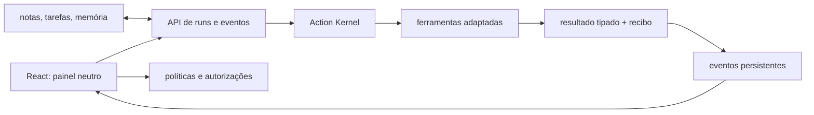

# Plan 016: Transformar o produto em um painel neutro de controle de IA

> **Executor instructions**: Execute as fases em ordem e registre a decisão ao
> término de cada uma. Este plano não autoriza uma reescrita integral, uma troca
> de framework de agente nem a cópia de código das referências. Preserve todas
> as alterações locais anteriores. Caso o contrato real do backend tenha mudado,
> pare e atualize este plano antes de continuar.
>
> **Drift check (run first)**: `git diff --stat 90a759a..HEAD -- app frontend tests plans`

## Status

**Em andamento — atualização em 2026-11-07:** entregue a camada visual neutra
(navegação compartilhada, shell, chat, controles, Início e Integrações) e o
primeiro incremento das fases 1 e 3: resultado tipado nos caminhos nativo e
de marcadores, guardrails por turno, aprovação única, estado/eventos de ação
transacionais em SQLite e histórico paginado com linha do tempo na Central.
O segundo incremento adicionou Run/eventos para turnos do chat com ferramentas,
recuperação após interrupção com runtime exclusivo e cancelamento cooperativo
entre etapas, além da lista/detalhes por pedido. Os 59 testes de núcleo/API,
TypeScript e dois testes de navegador passaram nessa etapa.
O terceiro incremento unificou a entrada do chat e do streaming, registrou os
atalhos locais e o modo ReAct e ligou cada resposta ao pedido na Central.
Execução por etapas oferece pesquisa, tempo, calendário, planejamento e quadro.
Uma proposta pendente encerra o planejamento e pode ser decidida na Central.
Ainda faltam rotinas, adaptadores internos dos especialistas, autorizações por
escopo, interrupção dentro de chamadas longas e integração do APK com o backend.
As fases 1–4 permanecem parciais. Detalhes de validação, migração e limites em
`docs/PROJECT_CONTINUITY.md`, seções de entrega de 2026-11-06 e 2026-11-07.

- **Priority**: P0
- **Effort**: L, entregue em seis fases incrementais
- **Risk**: HIGH — coordena ações que podem alterar arquivos, aplicativos,
  dispositivos e dados pessoais
- **Depends on**: `plans/006-isolated-verification-release-and-docs.md`,
  `plans/007-modularize-panel-and-tool-registry.md`
- **Category**: direction, architecture, correctness, UX
- **Planned at**: commit `90a759a`, 2026-11-04

## Resultado pretendido

O produto deve abrir como um painel neutro de trabalho, não como um personagem.
Uma pessoa consegue iniciar uma conversa ou automação, acompanhar uma execução
real, conferir a proposta de cada ação, limitar sua autonomia, interromper o
trabalho e revisar o resultado depois. Voz, orb, nome e personalidade continuam
possíveis como um perfil configurável, mas deixam de moldar a navegação e o
contrato técnico.

O termo “controle amplo” significa capacidade de operar ferramentas aprovadas
com escopo explícito. Não significa executar ações irreversíveis, rede, scripts
ou dispositivos sem identidade, limites, cancelamento e histórico verificável.

## Estado atual a preservar

- `app/agent/action_executor.py` já cria registros de ação e aplica uma
  confirmação única. `app/core/actions.py` redige argumentos sensíveis.
- `app/storage/action_store.py` guarda o estado atual e
  `app/ui/panel/api/mission_control.py` oferece um snapshot operacional.
- `app/core/control_plane.py` já contém política de host, origem e modo LAN.
- `frontend/src/pages/MissionControlPage.tsx` já exibe confirmações e histórico;
  `frontend/src/App.tsx` carrega páginas sob demanda.
- O Projeto AI contém regras de domínio para Nexus, mas seu bootstrap não
  registra as ferramentas essenciais e sua API Flask expõe CORS amplo em
  `src/services/visualizer_app.py`. Não portar esse transporte.
- As alterações não commitadas em `frontend/` e `mobile_app/` pertencem ao
  usuário. Nenhuma fase pode usar reset, clean, checkout ou build que reescreva
  assets Android rastreados.

## Comandos de verificação existentes

| Objetivo | Comando | Resultado esperado |
|---|---|---|
| Verificar tipos da UI | `Set-Location frontend; node .\node_modules\typescript\bin\tsc --noEmit -p tsconfig.json` | exit 0 |
| Testes isolados de núcleo | `python -B -m pytest -q -p no:cacheprovider tests/test_conversation_runtime.py tests/test_runs.py tests/test_action_history.py tests/test_orchestrator_action_results.py tests/test_action_kernel.py tests/test_actions.py tests/test_mission_control.py tests/test_native_action_boundary.py tests/test_guardrails_thread_safety.py tests/test_control_plane_security.py tests/test_tool_catalog.py` | 88 de núcleo. Com os 10 casos de integração e compatibilidade do orquestrador, 98 passaram. |
| Estado das alterações | `git status --short` | só mudanças planejadas mais as alterações preexistentes |

`npm run build` gera só `frontend/dist` e pode ser usado como verificação.
`npm run build:mobile` remove e recopia os assets móveis rastreados; não usá-lo
como verificação.

## Navegação alvo

| Área | Pergunta respondida | Conteúdo principal |
|---|---|---|
| Início | O que requer atenção agora? | resumo de runs, aprovações, próximas rotinas e conectores |
| Conversas | O que pedi e qual contexto foi usado? | chat, anexos, fontes, memória usada e run associado |
| Execuções | O que a IA está fazendo de verdade? | plano, eventos, ações, duração, custo, interrupção e resultado |
| Automações | O que pode rodar sem abrir o chat? | receitas, agenda, escopos autorizados e último recibo |
| Conhecimento | O que a IA sabe e de onde veio? | notas, documentos, memórias, tarefas e proveniência |
| Integrações | Quais ferramentas estão conectadas e saudáveis? | navegador, Windows, dispositivos, MCP futuro e permissões |
| Configurações | Quem é este agente e quais são seus limites? | perfil opcional, provedores, voz, política e dados |

Definir um único registro tipado de rotas para desktop, mobile e paleta de
comandos. Não manter listas independentes em `App.tsx`, `AppShell.tsx` e
`CommandPalette.tsx`.

## Fase 1: Tornar a execução uma fonte de verdade

**Incremento autorizado em 2026-11-06:** começar pelo ciclo de uma ação já
existente: preservar `ToolResult.ok`, unificar execução imediata/aprovada,
isolar guardrails por turno e persistir estado + eventos na mesma transação
SQLite. Expor a linha do tempo na Central e reforçar aprovação única com
argumentos congelados. Importar o JSONL anterior sem apagá-lo, identificando
seus registros como snapshots legados (sem inventar eventos passados).
Esse incremento não equivale ao `Run` de conversa inteiro; agrupamento de
ações por Run e cancelamento cooperativo permanecem na sequência.
**Entregue em 2026-11-07**, com migração validada em dados temporários; o banco
pessoal ainda não foi aberto pelo backend nesta validação.

1. **Entregue parcialmente em 2026-11-07:** contrato `Run` com `id`, origem, sessão, status, timestamps,
   cancelamento, política aplicada, `action_ids` e resultado terminal. Criar um
   `RunEvent` somente-acréscimo para plano, tool-call, proposta, aprovação,
   início, progresso, recibo, erro e cancelamento. Implementados eventos de
   criação, ações, término da resposta, transições, cancelamento e recuperação
   no chat com ferramentas. A lista de ações vem da relação `ActionRecord.run_id`.
   Plano/progresso detalhados e cobertura universal ainda faltam; não gravar
   deliberação interna nem o prompt integral no journal.
2. **Entregue:** `ActionExecutor` consome resultado tipado. Corrigida a redução
   de `ToolResult` a texto nos caminhos nativo e de marcadores do orquestrador.
   `ToolResult(ok=False)` gera ação `failed` e evento de falha, com o erro
   disponível para chat e Central. O marcador de uma ação com falha não mantém
   a mensagem otimista escrita antes da execução.
3. Fazer toda chamada — function calling, marcadores, voz, rotina e futuro MCP
   — passar por esse mesmo executor. Nenhum adaptador pode chamar uma ferramenta
   de alto impacto diretamente.
   **Terceiro incremento entregue.** Atalhos de tarefa/listagem e ferramentas do
   ReAct passam pelo executor. O chat HTTP, o streaming HTTP, o WebSocket e
   `/api/react` compartilham o pedido. Chamadas internas de especialistas,
   rotas diretas e tarefas em segundo plano seguem pendentes.
4. **Entregue para ações:** SQLite com transação por mudança de estado e evento,
   importação única do JSONL preservado como fonte legada e replay por cursor.
   Callbacks de aprovação ficam fora de disco; uma aprovação após reinício
   expira sem executar. **Segundo incremento entregue:** eventos de Run,
   reconciliação de `running` como `interrupted` e expiração de propostas na
   partida do runtime exclusivo. Leitores não fazem recuperação; não há replay
   automático de ferramentas. Retenção por pedido preserva grupos inteiros.

**Testes novos**: ToolResult de erro, exceção da ferramenta, aprovação única,
ordem de eventos, persistência e recuperação de run concluída. Cobrir dois
turnos concorrentes para não compartilhar guardrails entre eles.

## Fase 2: Cancelamento e autorização que correspondem à UI

1. Adicionar `run_id` e `CancellationToken` cooperativo no orquestrador,
   navegador, subprocessos e ferramentas que possam durar mais de um turno.
   A transição precisa admitir `running → cancel_requested → cancelled`.
   **Parcialmente entregue:** a API e o orquestrador usam esse ciclo com
   checkpoints entre ferramentas e chunks. Uma ferramenta já iniciada mantém
   `cancel_requested` até retornar. Ainda faltam tokens dentro dos adaptadores.
2. O botão de abortar deve chamar API de run e esperar evento terminal. O antigo
   `frontend/src/hooks/useQuestLog.ts` alterava apenas estado React; remover
   qualquer indicação de “abortado” que não tenha confirmação do backend.
   **Entregue na Central:** cancelar pedido chama a API e espera o estado real;
   o callback falso `abortQuest` e sua ligação na interface foram removidos.
   A migração do restante do Quest Log para Run permanece pendente.
3. Substituir previews genéricos de `ActionExecutor.propose` por uma proposta
   estruturada e redigida: capacidade, alvo, operação, escopo, efeito previsto,
   reversibilidade e limite. A UI não recebe credenciais, prompts completos ou
   conteúdo sensível.
4. Criar políticas explícitas por capacidade: observar, ler, perguntar sempre,
   permitir uma vez e permitir dentro de escopo persistido. Escopos incluem
   pastas autorizadas, aplicativo, dispositivo, domínio e teto temporal/custo.
   A revogação encerra o escopo e cancela runs dependentes quando possível.

**Done criteria**: uma ferramenta simulada longa pode ser cancelada; uma
ferramenta não cooperativa aparece como “cancelamento solicitado” em vez de
falsamente concluída; aprovação mostra alvo e efeito; nenhuma política é
decidida pelo modelo.

## Fase 3: Construir a Central de Execuções primeiro

1. Evoluir `MissionControlPage` para página “Execuções”, com lista paginada,
filtros por status/capacidade/origem, detalhes de um run e linha de tempo de
eventos. Corrigir mutações para verificar `response.ok` e manter o formulário
   quando houver falha. **Entregue:** pedidos por estado/sessão, detalhes,
   etapas, timeline, cancelamento e abertura da conversa; filtros por
   capacidade/origem e título do pedido ainda não implementados.
2. Substituir sinais fixos: `AppShell.tsx` não pode exibir `ONLINE` sem estado
real. Exibir `unknown`, `healthy`, `degraded` e `offline`, junto de idade da
última atualização e razão redigida.
3. Emitir eventos por polling curto inicialmente; introduzir streaming somente
depois que replay com `after_event_id` e reconexão forem testados. A UI deve ser
capaz de reconstruir a execução a partir da API, não apenas da memória React.
4. Migrar Quest Log para uma visualização de `Run` e `RunEvent`, depois apagar
o estado paralelo quando houver caracterização de comportamento.

**Teste de interface**: falha 409/410/500 não limpa rascunho nem apresenta
sucesso; desconexão mostra estado degradado; reload durante run recupera a linha
de tempo e o botão de cancelamento correto.

## Fase 4: Separar produto, perfil e módulos

1. Criar registro de rotas e trocar a navegação por: Início, Conversas,
Execuções, Automações, Conhecimento, Integrações e Configurações. Estudos e
Life OS entram como módulos habilitáveis, não como identidade do produto.
2. Mover marca, nome exibido, avatar/orb, tom de voz e instruções de persona
para `AgentProfile` configurável. Substituir strings e requisitos de build
específicos a Jarvis por identidade padrão neutra, sem apagar a opção de perfil
legado.
3. Criar `apiClient` único com erro estruturado, cancelamento HTTP e notificações
acessíveis. Migrar páginas por ordem: Execuções, Chat, Início, Integrações.
4. Manter compactação e semântica idêntica em mobile, mas esconder ações que não
tenham conexão confiável com o desktop. A fonte de rotas declara a capacidade de
cada superfície.

**Done criteria**: paleta, barra lateral e menu móvel mostram as mesmas áreas
permitidas; mudar perfil não muda autorizações; o painel continua funcional com
persona desativada.

## Fase 5: Adotar Nexus sem transportar seus riscos

1. Extrair do Projeto AI adaptadores de domínio para notas, tarefas, metas,
hábitos, finanças e estudos. Definir contratos de leitura/mutação que retornem
entidade, versão e link interno para que uma ação de chat abra o item criado.
2. Usar um backend configurado por instalação. Falha de Postgres não pode
silenciosamente trocar uma escrita para SQLite pessoal; em modo offline, enfileirar
operação idempotente e mostrar o backend efetivo no painel.
3. Importar dados somente por ferramenta administrativa com preview, backup e
relatório. Não apontar o Jarvis diretamente para `D:\Downloads\Projeto AI\data`.
4. Construir o workspace de Conhecimento a partir desses adapters e da memória
existente. Todo item informa fonte, data, dono e comando de remoção.

## Fase 6: Expandir integrações de modo mensurável

1. Registrar cada integração com manifest: capacidades, parâmetros, risco,
requisitos, timeout, cancelamento, escopo, health check e testes de contrato.
2. Priorizar: navegador via adaptador controlado, automação Windows com recibo,
arquivos dentro de escopo, e conectores de comunicação somente após confirmação
estruturada. MCP entra por adapter com lifecycle, timeout e autenticação; o
esqueleto no Projeto AI não deve ser portado como suporte pronto.
3. Workflows começam como receitas declarativas validadas e sempre simuladas.
Só habilitar execução após cada etapa poder produzir recibo, obedecer política e
ser cancelada. O atual `WorkflowTool` é corretamente apenas simulação.
4. Criar uma suíte de cenários reais em ambiente isolado: abrir uma página,
criar nota, importar documento, propor envio de mensagem, cancelar busca e
recuperar run após reinício. Medir sucesso, tempo, ações interrompidas e
aprovações equivocadas antes de elevar autonomia padrão.

## Referências de estudo

As cópias imutáveis estão em
`D:\Downloads\AI-Panel-References-TEMP-2026-11-04`. Consulte o `README.md` e
`ANALYSIS.md` dessa pasta para a lista de vinte projetos e licenças. Em especial:

- Jan para eventos, permissões e interrupção;
- LibreChat para workspaces, modos de aprovação e cancelamento;
- LangGraph para checkpoints e supervisão humana;
- CopilotKit e assistant-ui para estado compartilhado e UI de ação;
- OpenHands, OpenClaw, UFO e UI-TARS para operações observáveis;
- Letta, Hermes, AnythingLLM e Khoj para memória analisável.

## Limites e condições de parada

- Pare se a execução exigir elevar privilégios do Windows, expor serviço na LAN,
guardar credenciais na UI ou executar código produzido pelo modelo fora de
sandbox; esses itens precisam de uma decisão de segurança separada.
- Pare se um módulo do Projeto AI depender do banco pessoal existente, antes de
criar um adapter com armazenamento de teste.
- Não adicione framework de orquestração, fila distribuída ou multiagente só
porque uma referência os usa. Adote-os apenas após os contratos das Fases 1–3
não cobrirem uma necessidade observada.
- Não execute `npm run build:mobile` nem os scripts de APK contra o worktree atual
sem intenção de atualizar os assets Android rastreados. O build web
(`npm run build`) não altera `mobile_app/`.
